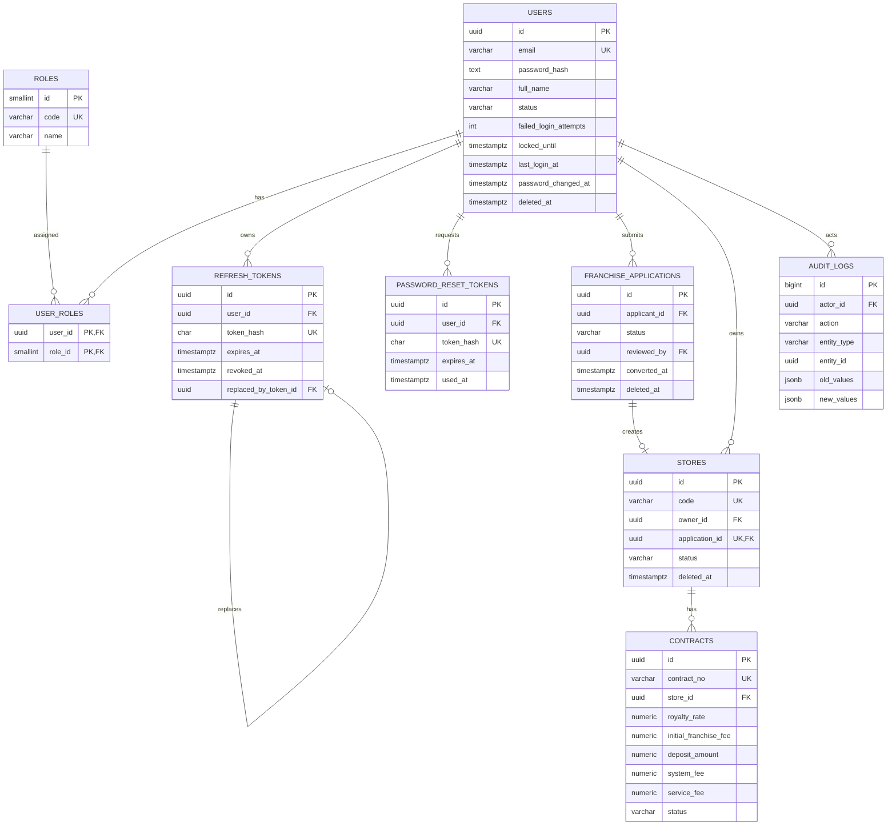
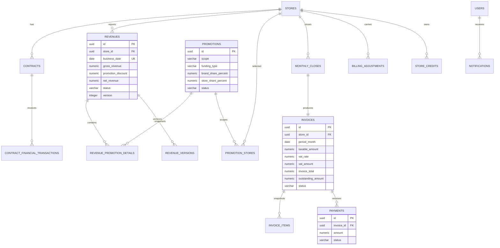

# ERD hiện tại

ERD này chỉ phản ánh phần backend đã triển khai, không mô tả trước Revenue,
Promotion, Invoice hoặc Payment.

Nguồn chính xác cuối cùng của schema là các file trong `database/migrations`.

## Billing và vận hành

