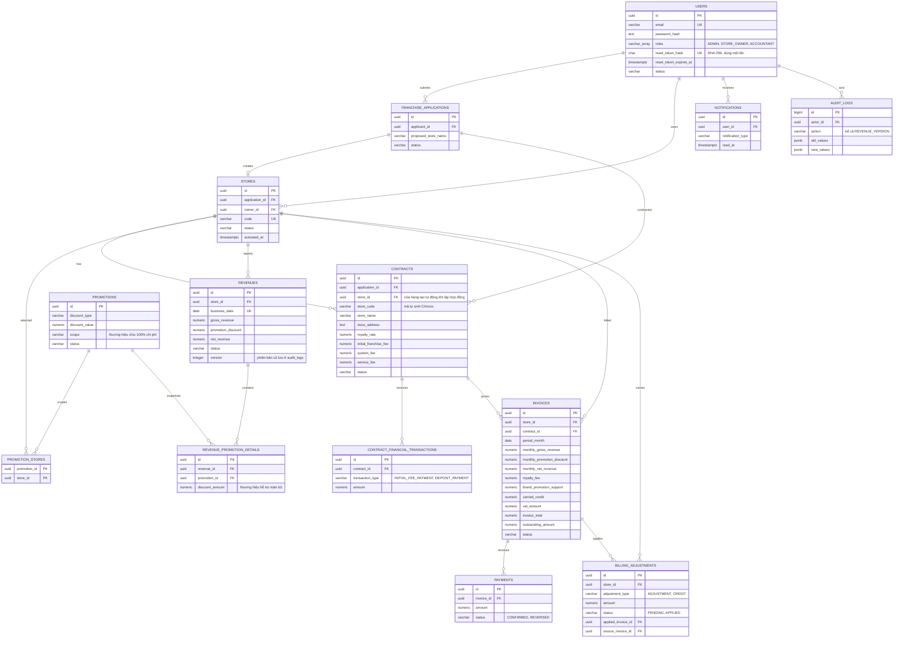

# ERD

Cơ sở dữ liệu gồm 14 bảng trong schema `app`
(`database/schema/001_create_all_tables.sql`), rút gọn từ 21 bảng ở bản thiết kế đầu.

## Các bảng đã gộp

| Bảng cũ | Nay nằm ở |
|---|---|
| `roles`, `user_roles` | `users.roles` (mảng, CHECK chỉ nhận 3 vai trò) |
| `password_reset_tokens` | `users.reset_token_hash`, `users.reset_token_expires_at` |
| `monthly_closes` | các cột tổng tháng trong `invoices` |
| `invoice_items` | tính từ các cột phí của `invoices` (`fn_get_invoice` trả về `items`) |
| `revenue_versions` | `audit_logs` với `action = 'REVENUE_VERSION'`, bản cũ trong `old_values` |
| `store_credits` | `billing_adjustments` với `adjustment_type = 'CREDIT'` (số tiền âm) |
